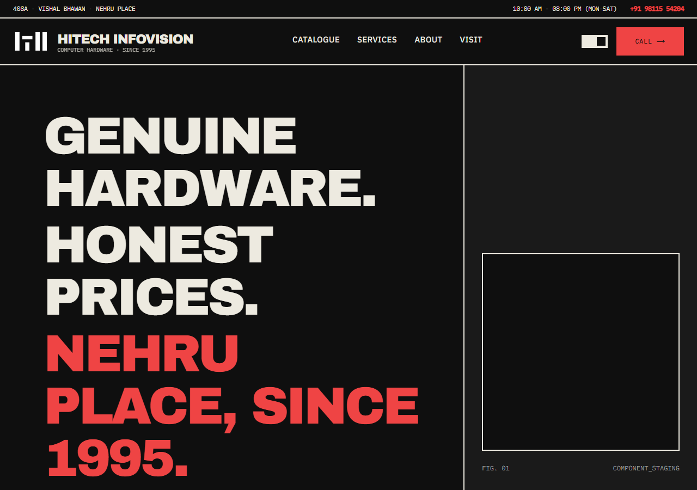

# Hitech Infovision

A full-stack storefront and admin system for Hitech Infovision, a computer-hardware shop in Nehru Place, New Delhi. It's live at [hitechinfovision.com](https://hitechinfovision.com) and carries the shop's real inventory.

This repository is a public summary. The source code is private.

## What it does

- **Storefront.** A filterable, paginated hardware catalogue with clean category URLs, product pages, a repair-services listing, and WhatsApp enquiries straight from any product.
- **Admin panel.** The owner manages products, categories, prices, discounts, coupons, services and shop details without touching code.
- **Server-side prices.** Every price and discount is worked out on the server, so the browser can't change what a customer is charged.
- **Audit trail.** Every admin change is recorded in an append-only log.
- **Layered security.** Protection at the network, auth, input and database layers, so no single control is a single point of failure.
- **Fast by default.** Pages are rendered on the server and arrive ready, with no loading spinners. That's good for customers and for search rankings.
- **Search-ready.** Structured data, generated sitemaps and dynamic social preview images.

## Design

The UI rejects the default SaaS look of rounded corners and soft shadows in favour of the rigid style of 20th-century technical manuals and Swiss industrial catalogues. The design system was built from scratch, with no UI component library and no icon library: typographic markers, hard rules, one signal colour, and monospace for every number.

## Built with

Next.js 16 (App Router), React Server Components, TypeScript, Supabase (PostgreSQL, Auth, Storage), Tailwind CSS v4, Zod, Vercel.

## More

- [Case study](https://github.com/euphoric-habromaniac/hitech-infovision-case-study)

## Rights

Copyright © 2026 Pranjal Kumar. All rights reserved. See [LICENSE](LICENSE).

Built for Hitech Infovision in Nehru Place, New Delhi.
